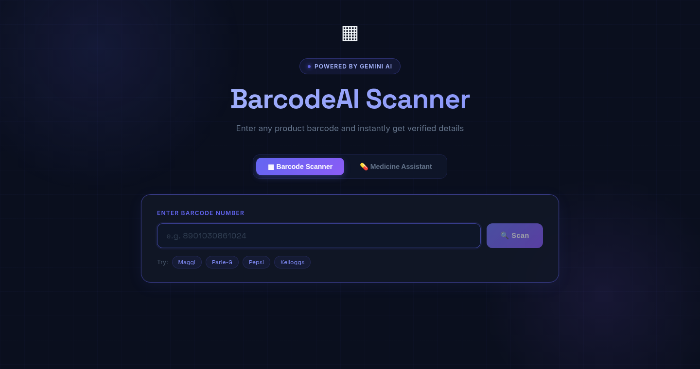
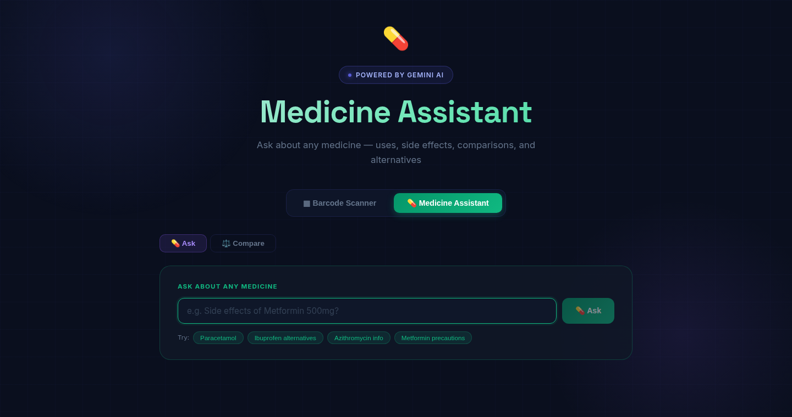

# Barcode Scanner

A React web app for barcode-based product lookups and a medicine assistant, backed by a FastAPI API.

## Screenshots

### Barcode Scanner



### Medicine Assistant



## Requirements

- Python 3.10 or newer
- Node.js and npm
- A Gemini API key for the AI-powered features

## Configure the backend

The backend reads `GEMINI_API_KEY` and `GEMINI_MODEL` from `backend/.env`. Start by copying the example file and add your Gemini API key:

```text
GEMINI_API_KEY=your_gemini_api_key
GEMINI_MODEL=gemini-3.5-flash-lite
```

You can create a key at [Google AI Studio](https://aistudio.google.com/app/apikey). Keep the key private; do not commit `backend/.env`.

## Run on Windows

Open PowerShell in the project root and set up the backend:

```powershell
cd backend
py -3 -m venv .venv
.\.venv\Scripts\Activate.ps1
python -m pip install -r requirements.txt
if (-not (Test-Path .env)) { Copy-Item .env.example .env }
```

Edit `backend/.env` and replace the example value with your Gemini API key. If PowerShell blocks virtual environment activation, either allow scripts for the current PowerShell session with `Set-ExecutionPolicy -Scope Process -ExecutionPolicy Bypass` and activate again, or use the venv's Python directly:

```powershell
.\.venv\Scripts\python.exe -m pip install -r requirements.txt
.\.venv\Scripts\python.exe -m uvicorn main:app --reload --port 8000
```

Otherwise, start the backend from the activated environment:

```powershell
python -m uvicorn main:app --reload --port 8000
```

Leave that terminal running. Open a second PowerShell window in the project root and start the frontend:

```powershell
cd frontend
npm install
npm start
```

## Run on Linux

Open a terminal in the project root and set up the backend:

```bash
cd backend
python3 -m venv .venv
source .venv/bin/activate
python -m pip install -r requirements.txt
if [ ! -f .env ]; then cp .env.example .env; fi
```

Edit `backend/.env` and replace the example value with your Gemini API key. Start the backend:

```bash
python -m uvicorn main:app --reload --port 8000
```

Leave that terminal running. In a second terminal at the project root, start the frontend:

```bash
cd frontend
npm install
npm start
```

## Open the application

- Frontend: [http://localhost:3000](http://localhost:3000)
- Backend health check: [http://localhost:8000/health](http://localhost:8000/health)
- Interactive API documentation: [http://localhost:8000/docs](http://localhost:8000/docs)

The frontend development server proxies API requests to the backend on port `8000`. The backend can start without a Gemini key, but AI-powered requests will return an error until `GEMINI_API_KEY` is configured.

To stop either server, press `Ctrl+C` in its terminal. On Linux, the repository also includes `start.sh` to install dependencies and start both development servers together.

## Product data sources and Gemini verification

For barcode lookups, the backend compares Gemini's product name and brand with its local FMCG catalog, loaded from the `backend/Indian_FMCG_Product_Catalog*.xlsx` files. When a barcode is present in that catalog, the catalog data is returned as the authoritative result, including when it does not match Gemini's response.

If a barcode is not in the local catalog, the app may return a confident Gemini response without independent verification. If Gemini cannot identify the product, the backend looks it up in [Open Food Facts India](https://in.openfoodfacts.org/) and [Open Food Facts](https://world.openfoodfacts.org/). Open Food Facts is a fallback data source, not a check of Gemini's response.

The medicine assistant does not currently fetch or verify answers against external medicine databases. Its Gemini prompts ask for sources such as [CDSCO](https://cdsco.gov.in/), [Tata 1mg](https://www.1mg.com/), [PharmEasy](https://pharmeasy.in/), [MedlinePlus](https://medlineplus.gov/), and [WHO](https://www.who.int/), but these are requested citations, not data sources integrated into the application. Check medical information with a qualified healthcare professional.
